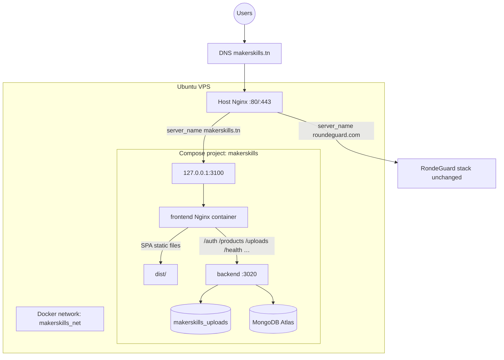
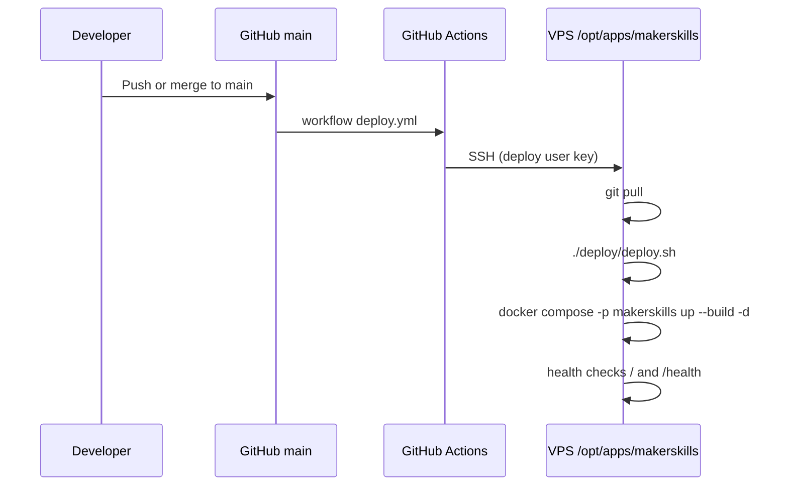

# Maker Skills — Architecture

## Overview

Maker Skills is a monorepo web application deployed as an **isolated Docker Compose project** on an Ubuntu VPS that also hosts an unrelated application (**RondeGuard**). The only intentionally shared infrastructure is the **host-level Nginx** reverse proxy and the VPS itself.

| Component | Technology |
|-----------|------------|
| Frontend | React 18 + Vite 5 + TypeScript + Tailwind (static SPA) |
| Backend | NestJS 11 + Mongoose |
| Database | MongoDB Atlas (external; no DB container in this stack) |
| Uploads | Local disk via Docker volume `makerskills_uploads` |
| Edge | Host Nginx (TLS) → `127.0.0.1:3100` → frontend container Nginx |

## System diagram



## Request flow

1. Browser loads `https://www.makerskills.tn/` (SPA from frontend container).
2. Browser calls same-origin API paths (`/events`, `/auth/login`, `/uploads/...`) because `VITE_API_URL` is empty at build time.
3. Frontend container Nginx proxies those paths to `http://backend:3020` on `makerskills_net`.
4. Backend reads/writes MongoDB Atlas and serves files from `/app/uploads`.

The backend has **no host port publish**. It is not reachable from the public internet except through the frontend proxy (and host Nginx in front of that).

## Repository layout

```text
.
├── frontend/                 # Vite React SPA + Nginx image
│   ├── Dockerfile
│   ├── nginx.conf
│   └── proxy_params.inc
├── backend/                  # NestJS API
│   └── Dockerfile
├── docker-compose.yml
├── .env.example
├── deploy/
│   ├── deploy.sh
│   └── nginx/makerskills.conf
├── .github/workflows/deploy.yml
├── ARCHITECTURE.md
└── DEPLOYMENT.md
```

## Isolation from RondeGuard

| Resource | Maker Skills | RondeGuard |
|----------|--------------|------------|
| Path on VPS | `/opt/apps/makerskills` | `/opt/apps/rondeguard` (unchanged) |
| Compose project | `makerskills` | separate |
| Network | `makerskills_net` | separate |
| Volumes | `makerskills_uploads` | separate |
| Host ports | `127.0.0.1:3100` only | existing ports (3000, 5000, …) |
| Nginx vhost | `makerskills.tn` | `roundeguard.com` |

## CI/CD flow



## Security boundaries

- Secrets live in `/opt/apps/makerskills/.env` on the server (never committed).
- No Docker socket mount.
- No shared secrets/networks/volumes with RondeGuard.
- HTTPS terminates at host Nginx; containers speak HTTP on the loopback / Docker network.
- Swagger UI is disabled when `NODE_ENV=production`.
- Dev user seeding controllers are disabled when `NODE_ENV=production`.
